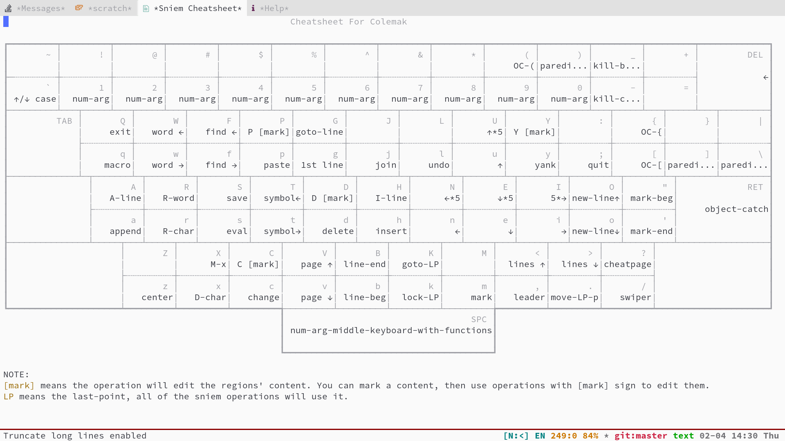

# Sniem

**Sniem** (*Hands-eased United Editing Method*) is a modular editing method package for
Emacs. It blends modal editing with a persistent `last-point`, a leader key, structural
pair catching, and a collection of editing commands designed to keep your hands on the
home row.

[简体中文](README.zh.md) | English



## Features

- **Five lightweight states** — `NORMAL`, `INSERT`, `MOTION`, `EXPAND`, and
  `MINIBUFFER-KEYPAD` — implemented as independent buffer-local minor modes.
- **`last-point`** — larger motions remember the point they started from; local cursor
  movement leaves an existing origin alone, and recent origins are kept in a trail.
- **Leader key** with a keypad for `C-`, `M-`, and `C-M-` prefixes.
- **Object catch** — select the nearest pair, its parent, or a pair of a given type,
  with awareness of nesting, strings, and escapes.
- **Marked content** — keep a set of overlays as a scratch list of regions, tag them,
  jump between them, and edit them all at once.
- **Middle-keyboard numeric argument** — type numbers with the home row instead of the
  numeric row, plus a set of editing commands on the same keys.
- **Enhanced keyboard macros** — apply a recorded macro to every selected line, or use
  the selected text as a search target for the recorded macro.
- **Search with highlighting** — jump between occurrences of a word or symbol and see
  all matches while you move.
- **Paste panel and special clipboard** — choose from the kill ring page by page, or
  collect snippets in a clipboard that is independent of the kill ring.
- **Comment marks** — insert and jump between `TODO`, `BUG`, `NOTE`, and custom tags.
- **Linked files** — group files together and reopen the group on demand.
- **Generated cheatsheet** — display the current key bindings for your keyboard layout.
- **State indicator** — a compact `[N:...]`, `[I:...]`, `[M]`, `[E:...]` string for the
  mode line, with automatic `awesome-tray` integration.

## Requirements

- Emacs 27.1 or newer
- [s](https://github.com/magnars/s.el) 2.12.0 or newer
- [dash](https://github.com/magnars/dash.el) 1.12.0 or newer

## Installation

```elisp
(use-package sniem
  :init
  (global-sniem-mode t)
  :config
  (sniem-set-keyboard-layout 'qwerty))
```

`global-sniem-mode` enables `sniem-mode` in every buffer and lets Sniem choose the
initial state for each buffer. If you prefer to enable it selectively, use
`(add-hook 'prog-mode-hook #'sniem-mode)` instead.

Calling `sniem-set-keyboard-layout` is important: it installs the movement and insertion
keys (`h`, `j`, `k`, `l`, `i`, ...) and records the layout used by the cheatsheet.
Without it, only the layout-independent bindings are available.

## Quick start

With the QWERTY layout loaded:

| Key | Action |
| --- | --- |
| `i` | Enter `INSERT` state |
| `ESC` | Return to `NORMAL` state |
| `SPC` | Middle-keyboard numeric argument / command menu |
| `,` | Leader key |
| `TAB` | Shift proxy (`TAB k` = `K`) |
| `RET` | Catch the nearest pair and enter `EXPAND` state |
| `?` | Show the cheatsheet |

## Concepts

### States

Sniem has five editing states. Each one is a separate buffer-local minor mode with its
own keymap, and switching to one state turns the others off.

| State | Activated in | Behaviour |
| --- | --- | --- |
| `NORMAL` | Editing buffers (see `sniem-normal-mode-alist`) | Full Sniem keymap for motions and editing. |
| `INSERT` | Buffers matching `sniem-insert-mode-alist` | Only `ESC` (configurable) is bound by Sniem; all other keys behave as usual. |
| `MOTION` | Buffers not matched by the normal or insert lists | Only `SPC` opens the leader; all other keys keep their original bindings. |
| `EXPAND` | Entered from `RET`, `M`, or Sniem commands | Pair navigation while a region is selected. Any other key exits and runs its `NORMAL` binding. |
| `MINIBUFFER-KEYPAD` | Toggled inside a minibuffer | Type keypad-prefixed keys (`C-`, `M-`, `C-M-`) without leaving the minibuffer. |

The state modes are layered through `emulation-mode-map-alists` rather than replacing
local maps, so Sniem cooperates with major modes and other minor modes.

When `sniem-mode` is enabled in a buffer, `sniem--enable` captures the buffer's original
`SPC` binding, picks the initial state, and registers the keymaps. Buffers matching
`sniem-close-mode-alist` are left alone.

### `last-point`

Motions are defined with the `sniem-define-motion` macro. For a motion that counts as a
large move, it records the point *before* the motion as `sniem-last-point`; the value is a
buffer-local marker, so edits before it move it along with the text.

To keep local navigation from destroying an origin, the motions in
`sniem-last-point-small-motions` do not replace an existing last point: plain character
and line movement (`h`, `j`, `k`, `l`) and `b`/`B`. They still initialize it when it is
nil, and a numeric prefix makes a repeated small motion count as a large move. Larger
jumps — word/symbol motion, `f`/`F`, paging, the `sniem-5-*` motions, line jumps, object
catch, and comment-mark jumps — do replace it.

- The `p` sub-commands of the delete, change, yank, and mark menus operate from
  `last-point` to the cursor.
- `.` (`sniem-move-last-point`) moves `last-point` to the current position.
- `n` (`sniem-lock-unlock-last-point`) locks or unlocks `last-point`. A locked point is
  shown with an overlay and is never overwritten by motions.
- `N` (`sniem-goto-last-point`) jumps back to it. If marked content exists in the
  buffer, `N` visits the marked contents instead; a numeric prefix selects a specific
  one, and repeated invocations cycle through them when there are several.
- Every change to `last-point` pushes the previous value onto a buffer-local trail.
  `sniem-last-point-from-trail` makes a trail entry the current `last-point` without
  moving point, so the next `p` operation can use that origin.
  `sniem-goto-last-point-from-trail` jumps to a trail entry instead. The trail keeps
  `sniem-last-point-trail-size` entries (16 by default).
- The two trail commands are not bound by default so they cannot shadow personal leader
  bindings. Bind them where they fit:

  ```elisp
  (sniem-leader-set-key
   "C-n" #'sniem-last-point-from-trail
   "C-N" #'sniem-goto-last-point-from-trail)
  ```

- With ivy, vertico, or helm, moving through the completion candidates previews the
  location in the buffer. Canceling restores the original point and window position;
  `sniem-last-point-from-trail` also returns to the original point after selection.

The normal-state `n` and `N` keep their lock/jump behavior and are not affected by the
trail commands.

### Leader key

The leader is bound to `,` in the normal keymap by default. Change it with:

```elisp
(sniem-set-leader-key ",")
```

The useful default leader bindings are:

| Key | Function |
| --- | --- |
| `x`, `c`, `v` | Keypad with a `C-` prefix |
| `m` | Keypad with an `M-` prefix |
| `b` | Keypad with a `C-M-` prefix |
| `SPC` | Replay the buffer's original `SPC` command |
| `TAB` | `sniem-shift` |

Add your own bindings with `sniem-leader-set-key`:

```elisp
(sniem-leader-set-key
 "d" #'sniem-digit-argument-or-fn
 "D" #'dired)
```

### Keyboard layouts

Sniem ships with keymaps for four layouts: `qwerty`, `colemak`, `dvorak`, and `dvp`
(Programmer Dvorak).

```elisp
(sniem-set-keyboard-layout 'qwerty)
;; or 'colemak, 'dvorak, 'dvp
```

The layout binds the following functions to hand-friendly keys (shown for QWERTY; each
layout has its own arrangement):

| Key | Function | Description |
| --- | --- | --- |
| `i` / `I` | `sniem-insert` / `sniem-insert-line` | Insert at point / at indentation. |
| `h` / `H` | `sniem-backward-char` / `sniem-5-backward-char` | Move left one / five characters. |
| `l` / `L` | `sniem-forward-char` / `sniem-5-forward-char` | Move right one / five characters. |
| `k` / `K` | `sniem-prev-line` / `sniem-5-prev-line` | Move up one / five lines. |
| `j` / `J` | `sniem-next-line` / `sniem-5-next-line` | Move down one / five lines. |
| `t` / `T` | `sniem-next-symbol` / `sniem-prev-symbol` | Move by symbol. |
| `e` | `sniem-join` | Join lines. |
| `u` | `undo` | Undo. |
| `n` / `N` | `sniem-lock-unlock-last-point` / `sniem-goto-last-point` | Lock / jump to `last-point`. |

## Key bindings

Key notation: `SPC` is the space bar, `RET` is Return, `DEL` is Backspace, and `C-`,
`M-`, `C-M-` are Control, Meta, and Control+Meta.

### Normal state

Editing and clipboard:

| Key | Command | Description |
| --- | --- | --- |
| `a` | `sniem-append` | Append after the cursor or at the end of the region. |
| `A` | `sniem-append-line` | Append at the end of the line. |
| `o` | `sniem-open-line` | Open a line below and enter `INSERT`. |
| `O` | `sniem-open-line-previous` | Open a line above and enter `INSERT`. |
| `r` | `sniem-replace-char` | Replace the character under the cursor. |
| `R` | `sniem-replace-word` | Replace the word or region (can pick a marked content). |
| `x` | `sniem-delete-char` | Delete the character under the cursor. |
| `c` | `sniem-change` | Change: `c` line, `p` from `last-point`, `e` to end of line. |
| `C` | `sniem-change-in-region` | Change inside the region. |
| `d` | `sniem-delete` | Delete: `d` line, `p` from `last-point`, `e` to end of line. |
| `D` | `sniem-delete-in-region` | Delete inside the region. |
| `y` | `sniem-yank` | Copy: `y` line, `p` from `last-point`. |
| `Y` | `sniem-yank-in-region` | Copy inside the region. |
| `p` | `sniem-paste` | Open the paste panel. |
| `P` | `sniem-paste-in-region` | Paste inside the region. |
| `` ` `` | `sniem-up-down-case` | Toggle the case of the character or region. |
| `"` | `sniem-split-line` | Split comma-separated content in the region into lines. |
| `q` | `sniem-macro` | Keyboard macro menu. |

Selection and structure:

| Key | Command | Description |
| --- | --- | --- |
| `m` | `sniem-mark` | Mark line, word, symbol, defun, buffer, from `last-point`, or with surrounding spaces. |
| `M` | `sniem-expand-enter-or-quit` | Toggle `EXPAND` state. |
| `'` | `sniem-mark-motion` | Adjust the active region: a following `'` swaps the edge, `q` shrinks, `;` grows. |
| `RET` | `sniem-expand-with-catch` | Catch the nearest pair and enter `EXPAND`. |
| `(` `[` `{` | `sniem-object-catch-char` | Catch the nearest pair. |
| `)` `]` `}` | `sniem-object-catch-parent` | Catch the parent pair. |
| `C-RET` | `sniem-object-catch-by-char` | Read an opening character, then catch that pair. |
| `M-RET` | `sniem-object-catch-parent` | Catch the parent of the current selection. |
| `C-M-RET` | `sniem-object-catch-parent-by-char` | Read a character, then catch its parent pair. |
| `TAB` | `sniem-shift` | Shift proxy; see below. |
| `SPC` | `sniem-digit-argument-or-fn` | Middle-keyboard numeric argument and commands. |

Motion and navigation:

| Key | Command | Description |
| --- | --- | --- |
| `b` / `B` | `sniem-beginning-of-line` / `sniem-end-of-line` | Beginning / end of line. |
| `g` / `G` | `sniem-first-line` / `sniem-goto-line` | First line / go to a line. |
| `<` / `>` | `sniem-goto-prev` / `sniem-goto-next` | Move by a typed number of lines. |
| `/` | `isearch-forward` | Regular incremental search. |
| `f` / `F` | `sniem-find-forward` / `sniem-find-backward` | Find a character, with a motion hint. |
| `w` / `W` | `sniem-next-word` / `sniem-prev-word` | Next / previous word; with a region, next / previous occurrence. |
| `v` / `V` | `sniem-scroll-up-command` / `sniem-scroll-down-command` | Scroll. |
| `DEL` | `sniem-backward-char` | Move left. |
| `1`–`9`, `0` | `digit-argument` | Standard numeric prefix. |

Other:

| Key | Command | Description |
| --- | --- | --- |
| `s` | `sniem-search` | Search, with highlighting of all matches. |
| `S` | `save-buffer` | Save the buffer. |
| `X` | `execute-extended-command` | `M-x`. |
| `z` | `sniem-center` | Center the line: `z` center, `t` top, `b` bottom. |
| `Q` | `save-buffers-kill-terminal` | Exit Emacs. |
| `;` | `sniem-keyboard-quit` | `C-g`; while a region is active during macro recording, deactivates the region instead of aborting the recording. |
| `-` | `kill-current-buffer` | Kill the current buffer. |
| `_` | `kill-buffer-and-window` | Kill the buffer and its window. |
| `.` | `sniem-move-last-point` | Move `last-point` to the cursor. |
| `?` | `sniem-cheatsheet` | Show the generated cheatsheet. |

Commands whose names end in `-in-region` operate on the inside of the region — from one
character after its beginning to one character before its end — so they compose naturally
with object catch. When a region is active, the plain `d`, `c`, and `y` commands act on
it directly instead of showing their menus.

When one of the `m`, `d`, `c`, or `y` menus is opened, Sniem briefly highlights the span
between `last-point` and point. The highlight is removed when the menu key is read, so a
`p` sub-command acts on exactly the span that was shown.

### Expand state

`EXPAND` is a transient state for growing a selection around structured text. The
uppercase variants select the parent pair of the same type.

| Key | Description |
| --- | --- |
| `RET` | Catch the nearest pair again. |
| `p` | Catch the parent pair (any pair type). |
| `r` | Repeat the last catch. |
| `b` / `B` | Catch by an opening character / its parent. |
| `o` / `O` | Catch `()` / its parent. |
| `s` / `S` | Catch `[]` / its parent. |
| `c` / `C` | Catch `{}` / its parent. |
| `q` / `Q` | Catch `''` / its parent. |
| `d` / `D` | Catch `""` / its parent. |
| `a` / `A` | Catch `<>` / its parent. |
| `/` | Reverse the catch direction. |
| `.` | Toggle expanding: keep the previous selection and extend it. |
| `TAB` | `sniem-shift`. |
| Any other key | Leave `EXPAND` and run its `NORMAL` binding. |

### Middle-keyboard numeric argument

Press `SPC` in `NORMAL` state to start. The home-row keys stand in for digits, and the
number is finished with `RET`:

| Digit | QWERTY | Colemak | Dvorak |
| --- | --- | --- | --- |
| `1` | `a` | `a` | `a` |
| `2` | `s` | `r` | `o` |
| `3` | `d` | `s` | `e` |
| `4` | `f` | `t` | `u` |
| `5` | `g` | `d` | `i` |
| `6` | `h` | `h` | `d` |
| `7` | `j` | `n` | `h` |
| `8` | `k` | `e` | `t` |
| `9` | `l` | `i` | `n` |
| `0` | `;` | `o` | `s` |
| `-` | `'` | `-` | `-` |

The same prompt also accepts commands:

| Key | Command | Description |
| --- | --- | --- |
| `RET` | — | Finish the number. |
| `DEL` | — | Delete the last digit. |
| `TAB u` | — | Add a `C-u` universal argument. |
| `.` | `sniem-mark-content` | Mark or unmark content; `0` then `.` clears marks. |
| `k` | `sniem-unmark-content-select-it` | Unmark the content at point and select it. |
| `K` | `sniem-mark-content-pop` | Remove the newest marked content. |
| `SPC` | `sniem-move-with-hint-num` | Repeat the last hinted motion N times. |
| `/` | `sniem-object-catch-direction-reverse` | Reverse the object-catch direction. |
| `,` | `sniem-object-catch-repeat` | Repeat the last object catch. |
| `p` | `sniem-pair` | Add, change, or remove the pair around the region. |
| `m` | `sniem-mark-jump-insert-with-name` | Insert a comment mark. |
| `<` / `>` | `sniem-mark-jump-prev` / `sniem-mark-jump-next` | Jump to comment marks. |
| `c` | `sniem-special-clipboard-clear` | Clear the special clipboard. |
| `x` | `sniem-special-clipboard-pop` | Pop the newest special-clipboard entry. |
| `f` | `sniem-linked-file-pannel` | Linked-file panel. |
| `R` | `sniem-edit-marked-content` | Replace every untagged marked content with new text. |
| `I` | `sniem-ignore-or-enable-marked-content` | Ignore or re-enable marked content. |
| `T` | `sniem-handle-tag-mark` | Add or remove a tag on marked content. |
| `j` | `sniem-jump-to-tag-mark` | Jump to a tagged marked content. |
| `N` | `sniem-ignore-or-enable-indentation` | Ignore or restore the file's indentation. |
| `P` | `sniem-paste` with special clipboard | Paste from the special clipboard. |
| `y` | `sniem-yank` with special clipboard | Copy to the special clipboard. |
| `Y` | `sniem-yank-in-region` with special clipboard | Copy the region to the special clipboard. |

### Keypad

The keypad lets you type chorded keys without holding modifiers. Open it from the
leader with `x`, `c`, or `v` (for `C-`), `m` (for `M-`), or `b` (for `C-M-`). Inside
the keypad:

| Key | Effect |
| --- | --- |
| `,` | Switch the prefix to `C-`. |
| `.` | Switch the prefix to `M-`. |
| `/` | Switch the prefix to `C-M-`. |
| `SPC` | Send the next key literally. |
| `DEL` | Delete the last key. |
| `;` | Quit the keypad. |
| `TAB` | Apply `sniem-shift` to the next key. |

The built key sequence is executed as a command, so `x r` runs `C-r`, and `m x`
runs `M-x` (when that binding exists).

In a minibuffer, press `SPC` twice to toggle `MINIBUFFER-KEYPAD`; press it twice again
to leave. There, `,`, `.`, and `/` directly map to `C-`, `M-`, and `C-M-`, while other
characters are inserted normally.

### `sniem-shift`

`sniem-shift` is bound to `TAB` in the normal and expand keymaps. It reads the next key
and applies a shifted version of it:

- `TAB k` runs the command bound to `K`.
- `TAB '` runs the command bound to `"` (`sniem-split-line`).
- Other shifted characters are mapped to their shifted symbols.
- `TAB TAB TAB` toggles a caps-lock-like mode (`sniem-shift-lock`), which swaps the case
  of self-inserted characters in `INSERT` state.
- After two `TAB` presses, any key other than `TAB` cancels the shift, like `C-g`.

## Features in detail

### Object catch

Object catch selects a region around a delimiter pair without requiring you to place
the cursor exactly on the delimiter. It searches outward for an opening character,
finds its matching closing character while respecting nesting, strings, comments, and
backslash escapes, and then selects the whole pair.

Pairs are defined in `sniem-object-catch-global-symbol-alist`. The default list covers
`()`, `[]`, `{}`, `<>`, `''`, and `""`, with an Emacs Lisp special case for backquote
and quote forms. Add global pairs with `add-to-list`, or define mode-specific pairs:

```elisp
(add-to-list 'sniem-object-catch-global-symbol-alist '("^" . "^"))

(sniem-object-catch-mode-defalist emacs-lisp-mode
  ("`" . "'")
  ("'" . ""))  ; An empty closing string removes this pair for the mode.
```

`RET` catches the nearest pair and enters `EXPAND`; `M-RET` catches the parent of the
current selection; `C-RET` and `C-M-RET` first read an opening character. `(`/`[`/`{`
and their closing counterparts offer quick access without a prompt. In `EXPAND`, the
direction can be reversed with `/`, the last catch repeated with `r`, and the selection
can be extended to adjacent structures with `.`.

### Search and occurrence navigation

`sniem-search` (bound to `s`) reads a regexp, completing from `regexp-search-ring`:

- Without a prefix argument, the text is used as-is.
- With a prefix argument, it is wrapped in symbol-boundary regexps.
- All matches are highlighted with overlays, and a `[current/total]` hint is shown at
  the end of the line.
- `w`/`W` with an active region jump to the next/previous occurrence of that text and
  keep the highlight set in sync.

### Marked content

Marked content is different from the normal Emacs region: each marked content is an
overlay that stays put while you move around. It is useful for collecting several
places and then operating on all of them.

| Command | Key | Effect |
| --- | --- | --- |
| `sniem-mark-content` | `SPC .` | Mark the region or character, or unmark the content at point. `SPC 0 .` clears untagged, tagged, or all marks. |
| `sniem-unmark-content-select-it` | `SPC k` | Remove the mark and select the content. |
| `sniem-mark-content-pop` | `SPC K` | Remove the newest marked content. |
| `sniem-edit-marked-content` | `SPC R` | Replace every untagged marked content with new text. |
| `sniem-handle-tag-mark` | `SPC T` | Give the content at point a name (or remove an existing tag). The current function name is offered as a default. |
| `sniem-jump-to-tag-mark` | `SPC j` | Jump to a named marked content, switching buffers if necessary. |
| `sniem-ignore-or-enable-marked-content` | `SPC I` | Make `last-point` take priority over marked content, or restore it. |

Marked-content overlays are repaired by an idle timer if an edit leaves them with an
empty range. Tagged marks are written to `sniem-mark-content-file` when Emacs exits;
`sniem--restore-tagged-overlays` can read that file back. The untagged list can be
navigated with `sniem-goto-last-point` (`N` in QWERTY).

### Paste panel and special clipboard

`sniem-paste` (bound to `p`) opens a panel with four kill-ring entries per page:

- `n` goes to the next page, `p` to the previous page.
- `1`–`4` inserts the corresponding entry.
- Pressing `p` on the first page pastes the first entry.
- `q` cancels.
- If a region is active, the chosen entry replaces the region.
- Inserted text is stripped of text properties.

The special clipboard is a separate list (`sniem-special-clipboard`) that never touches
the kill ring. With a region selected, copy into it with `SPC y` / `SPC Y`, paste with
`SPC P`, pop the newest entry with `SPC x`, and clear it with `SPC c`.

### Keyboard macros

`sniem-macro` (bound to `q`) provides a menu around the built-in keyboard macros:

| Key | Action |
| --- | --- |
| `q` | Start or stop recording. |
| `e` | Execute the last macro, or the locked macro if one is locked. |
| `n` | Name the last macro. |
| `l` | Lock or unlock the most recent macro. |
| `.` | Forcibly lock the most recent macro. |
| `c` | Call a named macro. |
| `i` | Insert a named macro into `sniem-macro-file`. |
| `;` | Clear the macro range and remembered content. |

Two behaviours go beyond plain `kmacro`:

- If a multi-line region is active when recording starts, the macro is replayed on every
  line of that region when recording stops.
- If a region inside a single line is active, its text is remembered as the macro's
  target; `sniem-next-word` / `sniem-prev-word` then jump to the next/previous
  occurrence of that text.

### Comment marks

`sniem-mark-jump` manages comment markers such as `TODO`, `BUG`, and `NOTE`.

- `sniem-mark-jump-insert` prompts for a type and inserts a properly commented marker,
  using the buffer's `comment-start`/`comment-end` and entering `INSERT` state.
- `sniem-mark-jump-insert-with-name` (bound to `SPC m`) does the same, and a prefix
  argument also prompts for the author name.
- `sniem-mark-jump-next` / `sniem-mark-jump-prev` jump between markers; with a numeric
  prefix, the number selects the type from `sniem-mark-jump-items`.
- `sniem-mark-jump-author-name` supplies the author. When it is nil and
  `sniem-mark-jump-author-name-enable` is non-nil, Sniem asks for a name each time; an
  empty answer inserts no author.

Customize the marker types with:

```elisp
(sniem-mark-jump-set-items :add "FIXME")
(sniem-mark-jump-set-items :delete "NOTE")
```

### Linked files

The linked-file panel groups related files (for example, a header and its
implementation) so they can be reopened together.

- `SPC f r` sets the current file as the root of a group.
- `SPC f l` adds the current file to the group.
- `SPC f s` saves the group.
- `SPC f o` opens every file in the current group.
- `SPC f c` clears the in-memory group.

The group is stored in a `SNIEM_LINKED_FILE` file at the project root (the nearest
ancestor directory containing `.git`), and that file is added to the project's
`.gitignore`.

### Cheatsheet and state indicator

`?` builds a `*Sniem Cheatsheet*` buffer for the current `sniem-keyboard-layout`. It
shows the physical keyboard, each bound command, and notes about `[mark]` and `LP`
(`last-point`). It requires a layout to be set.

`sniem-state` returns a compact state string:

| State | Example |
| --- | --- |
| `NORMAL` | `[N:>:l:2]` (`>` forward catch direction, `:l` locked last point, `:2` two marked contents) |
| `INSERT` | `[I:a]` / `[I:A]` (shift lock off/on) |
| `MOTION` | `[M]` |
| `EXPAND` | `[E:>]` (catch direction) |

If `awesome-tray` is loaded, Sniem registers the state as an `awesome-tray` module. With
the default mode line, add it manually:

```elisp
(setq-default mode-line-format (append '((:eval (sniem-state))) mode-line-format))
(force-mode-line-update)
```

## Customization

### Key bindings

```elisp
;; Leader map
(sniem-leader-set-key "d" #'sniem-digit-argument-or-fn
                      "D" #'dired)

;; Normal-state map
(sniem-normal-set-key "K" #'kill-whole-line)

;; Expand-state map
(sniem-expand-set-key "x" #'some-command)

;; Change the leader key and the insert-quit key
(sniem-set-leader-key ",")
(sniem-set-quit-insert-key "<escape>")
```

The three map setters accept pairs of `KEY FUNCTION`, so any number of bindings can be
added in one call.

### States and cursors

- `sniem-normal-mode-alist` — major modes (and their derived modes) that start in
  `NORMAL`.
- `sniem-insert-mode-alist` — major modes that start in `INSERT`.
- `sniem-close-mode-alist` — major modes where Sniem stays disabled.
- `sniem-normal-mode-cursor`, `sniem-insert-mode-cursor`, `sniem-motion-mode-cursor` —
  cursor types for the normal, insert, and motion states.

```elisp
(add-to-list 'sniem-normal-mode-alist 'org-mode)
(add-to-list 'sniem-insert-mode-alist 'comint-mode)
(add-to-list 'sniem-close-mode-alist 'special-mode)
```

### Last-point behavior

- `sniem-last-point-small-motions` — motions that keep an existing `last-point` intact.
  They still initialize it when it is nil; a numeric prefix makes a repeated small
  motion count as a large one.
- `sniem-last-point-trail-size` — number of previous `last-point` values kept for
  `sniem-last-point-from-trail` and `sniem-goto-last-point-from-trail` (default 16).
- `sniem-span-preview` — whether the menu span preview is shown.
- `sniem-last-point-trail-hint` — whether visible trail positions are marked with
  numbered badges while a menu is waiting for a key (on by default). It is independent
  of `sniem-span-preview`.
- While a menu is open, typing a visible trail number makes that position the current
  `last-point` and keeps the menu open. `RET` confirms the number; another menu key
  confirms it and acts immediately. Numbers may be multiple digits, and there is no
  conflict with the `TAB` line action in `sniem-delete`: its `9` in the code is ASCII 9
  (`TAB`), so the digit `9` still selects trail #9 normally.
- `sniem-last-point-trail` is the buffer-local list of trail markers. Treat it as state,
  not configuration.

### Marks, pairs, and connectors

- `sniem-mark-connectors` controls which characters are treated as part of a symbol
  when marking. Add or replace the entry for a mode with
  `sniem-mark-set-connector`:

```elisp
(sniem-mark-set-connector 'global "_")
(sniem-mark-set-connector 'python-mode :expand '("."))
(sniem-mark-set-connector 'c-mode :expand '("&" "*" (":" ":") ("-" ">")))
```

- `sniem-object-catch-global-symbol-alist` defines catchable pairs; see
  [Object catch](#object-catch).
- `sniem-pair` (via `SPC p`) uses the same alist. With a region selected, it wraps the
  region in the requested pair; `a` in its prompt forces adding a pair, and `s` toggles
  spaces around the selection.
- `sniem-shift--not-alpha-p` decides whether a character is treated as punctuation
  during marking and expansion.

### Hooks

| Hook | Runs when |
| --- | --- |
| `sniem-insert-to-normal-hook` | `INSERT` changes to `NORMAL`. |
| `sniem-normal-to-insert-hook` | `NORMAL` changes to `INSERT`. |

### Messages, timing, and faces

- `sniem-center-message`, `sniem-mark-message`, `sniem-delete-message`,
  `sniem-change-message`, `sniem-yank-message`, `sniem-macro-message`,
  `sniem-pair-message`, `sniem-paste-message`, `sniem-linked-file-message` contain the
  prompts for the corresponding menus. Set them to nil to remove the prompts.
- `sniem-motion-hint-sit-time` controls how long motion hints are displayed (default 1
  second).
- `sniem-motion-hint-face`, `sniem-edit-content-face`, `sniem-span-preview-face`, and
  `sniem-mark-content-file` control the hint face, the face for content marked with an
  "edit" argument, the menu span preview face, and the tagged-mark storage file.
- `sniem-span-preview` controls whether the last-point span is previewed while a menu
  key is being read (on by default).
- `sniem-last-point-trail-hint` controls the numbered trail badges shown alongside that
  preview. Badges are numbered in visible order, use `sniem-motion-hint-face`, and only
  appear in the selected window. Typing a number selects that trail position; `RET`
  keeps the menu open, while another key selects and acts.
- `sniem-ignore-or-enable-indentation` (via `SPC N`) tells `sniem-beginning-of-line`
  not to run indentation for buffers whose indentation is unreliable.

### Integration

- `wdired`: entering `wdired` switches to `NORMAL`, leaving it switches to `MOTION`.
- `org-cycle`: at the beginning of a line or in `INSERT` state, the original command
  runs; otherwise `TAB` behaves as `sniem-shift`.
- `yasnippet`: when yasnippet uses `TAB`, expansion is kept in `INSERT` state and routed
  through `sniem-shift` elsewhere.
- `awesome-tray`: the state string is registered automatically.

## Project structure

| File | Responsibility |
| --- | --- |
| `sniem.el` | Entry point: modes, state switching, keypad, numeric argument, shift, `last-point`, marked content, state string, key/layout helpers. |
| `sniem-var.el` | All `defcustom`/`defvar`/`defface` declarations and the default keymaps. |
| `sniem-operation.el` | Editing commands, motions, search, paste, pairs, keyboard macros, and the last-point trail UI. |
| `sniem-object-catch.el` | Pair detection and selection, plus `EXPAND` navigation. |
| `sniem-mark-jump.el` | Comment marks (`TODO`, `BUG`, `NOTE`, and custom types). |
| `sniem-linked-file.el` | Linked-file groups stored in the project root. |
| `sniem-cheatsheet.el` | Generation of the layout cheatsheet. |
| `sniem-common.el` | Shared helpers: last-point marker and trail accessors, motion hint, numeric reader, list utilities. |
| `sniem-macro.el` | The `sniem-define-motion` macro. |

### How the pieces fit together

1. `global-sniem-mode` enables `sniem-mode` in buffers.
2. `sniem-mode` calls `sniem--enable`, which captures the original `SPC` binding,
   chooses the initial state, and installs the keymaps in
   `emulation-mode-map-alists`.
3. Each state is a buffer-local minor mode with its own keymap. `sniem-change-mode`
   switches between them, updates the cursor, and runs the transition hooks.
4. Larger motions record `sniem-last-point` (through `sniem-define-motion`) and push the
   previous value onto a buffer-local trail. Commands manage overlays for search
   results, marked content, motion hints, and the last point.
5. Optional integrations and add-ons (wdired, org, yasnippet, awesome-tray, linked
   files, comment marks) are layered on top without changing the core state machine.

## License

Sniem is distributed under the GNU General Public License, version 3 or later. See
[LICENSE](LICENSE) for the full text.
