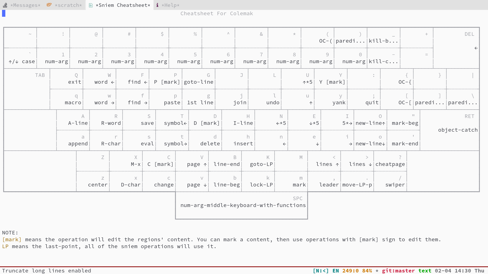

# Sniem

**Sniem**（*Hands-eased United Editing Method*，得心应手的统一编辑方法）是 Emacs 的
模块化编辑方法包。它将模态编辑与贯穿始终的 `last-point`、leader 键、结构化配对抓取，
以及一组让双手尽量停留在主键区的编辑命令结合起来。

[English](README.md) | 简体中文



## 特性

- **五种轻量状态**：`NORMAL`、`INSERT`、`MOTION`、`EXPAND` 和
  `MINIBUFFER-KEYPAD`，每一种都是独立的缓冲区局部 minor mode。
- **`last-point`**：每个动作都会记住起点，大多数编辑命令可以作用在 `last-point` 与
  光标之间。
- **Leader 键**，并附带用于 `C-`、`M-`、`C-M-` 前缀的 keypad。
- **Object catch**：抓取最近的配对、其父级配对，或指定类型的配对，并能识别嵌套、
  字符串与转义字符。
- **标记内容**：把一组区域作为覆盖层收集起来，可以打标签、在它们之间跳转，也可以
  一次性编辑全部内容。
- **主键盘数字参数**：用主键区代替数字行输入数字，同一组按键上还提供了编辑命令。
- **增强的键盘宏**：把录制的宏应用到选中的每一行，或把选中的文本作为宏的搜索目标。
- **带高亮的搜索**：在单词或符号的各个出现位置之间跳转，并在移动时查看全部匹配。
- **粘贴面板与特殊剪贴板**：按页从 kill ring 中选择内容，或把片段收集到独立于
  kill ring 的剪贴板中。
- **注释标记**：插入 `TODO`、`BUG`、`NOTE` 以及自定义类型的标记，并在它们之间跳转。
- **关联文件**：把若干文件分为一组，需要时一起重新打开。
- **自动生成的速查表**：显示当前键盘布局下的按键绑定。
- **状态指示器**：用于 mode line 的紧凑 `[N:...]`、`[I:...]`、`[M]`、`[E:...]`
  字符串，并自动集成 `awesome-tray`。

## 依赖

- Emacs 27.1 或更新版本
- [s](https://github.com/magnars/s.el) 2.12.0 或更新版本
- [dash](https://github.com/magnars/dash.el) 1.12.0 或更新版本

## 安装

```elisp
(use-package sniem
  :init
  (global-sniem-mode t)
  :config
  (sniem-set-keyboard-layout 'qwerty))
```

`global-sniem-mode` 会在所有缓冲区中启用 `sniem-mode`，由 Sniem 为每个缓冲区选择
初始状态。如果只想在部分缓冲区中启用，可以改用
`(add-hook 'prog-mode-hook #'sniem-mode)`。

调用 `sniem-set-keyboard-layout` 很重要：它会安装移动与插入相关的按键
（`h`、`j`、`k`、`l`、`i` 等），并记录速查表所使用的布局。不设置布局时，只有与
布局无关的按键可用。

## 快速上手

以 QWERTY 布局为例：

| 按键 | 作用 |
| --- | --- |
| `i` | 进入 `INSERT` 状态 |
| `ESC` | 返回 `NORMAL` 状态 |
| `SPC` | 主键盘数字参数 / 命令菜单 |
| `,` | Leader 键 |
| `TAB` | Shift 代理（`TAB k` 等于 `K`） |
| `RET` | 抓取最近的配对并进入 `EXPAND` 状态 |
| `?` | 显示速查表 |

## 核心概念

### 状态

Sniem 有五种编辑状态。每种状态都是一个独立的缓冲区局部 minor mode，拥有自己的
keymap；切换到其中一种状态时，其它状态会被关闭。

| 状态 | 启用条件 | 行为 |
| --- | --- | --- |
| `NORMAL` | 编辑缓冲区（见 `sniem-normal-mode-alist`） | 完整的 Sniem 移动与编辑 keymap。 |
| `INSERT` | 匹配 `sniem-insert-mode-alist` 的缓冲区 | Sniem 只绑定 `ESC`（可配置），其它按键保持原样。 |
| `MOTION` | 不属于 normal 或 insert 列表的缓冲区 | 只有 `SPC` 会打开 leader，其它按键保持原有绑定。 |
| `EXPAND` | 从 `RET`、`M` 或 Sniem 命令进入 | 在选中区域时进行配对导航；按其它键会退出并执行该键在 `NORMAL` 中的绑定。 |
| `MINIBUFFER-KEYPAD` | 在 minibuffer 中切换 | 无需离开 minibuffer 即可输入 keypad 前缀（`C-`、`M-`、`C-M-`）。 |

这些状态通过 `emulation-mode-map-alists` 叠加，而不是替换局部 keymap，因此 Sniem
可以与主模式及其它 minor mode 协作。

在缓冲区中启用 `sniem-mode` 时，`sniem--enable` 会保存缓冲区原有的 `SPC` 绑定，
选择初始状态，并注册 keymap。匹配 `sniem-close-mode-alist` 的缓冲区不会被处理。

### `last-point`

大多数动作由 `sniem-define-motion` 宏定义，它会在动作执行前把当前位置记录为
`sniem-last-point`。实际使用中该值是缓冲区局部的。

- 删除、修改、复制和标记菜单中的 `p` 子命令都以 `last-point` 到光标之间的范围
  作为操作对象。
- `.`（`sniem-move-last-point`）把 `last-point` 移到当前位置。
- `n`（`sniem-lock-unlock-last-point`）锁定或解锁 `last-point`。锁定后会以覆盖层
  显示，并且不会再被动作覆盖。
- `N`（`sniem-goto-last-point`）跳回 `last-point`。如果缓冲区中存在标记内容，`N`
  会改为在这些标记内容之间跳转；数字前缀可以指定其中一个，有多个标记时重复执行则会
  循环。

### Leader 键

默认情况下，leader 绑定在 normal 状态的 keymap 中的 `,` 上。可以用下面的方式修改：

```elisp
(sniem-set-leader-key ",")
```

默认 leader keymap 中可用的绑定包括：

| 按键 | 功能 |
| --- | --- |
| `x`、`c`、`v` | 以 `C-` 为前缀的 keypad |
| `m` | 以 `M-` 为前缀的 keypad |
| `b` | 以 `C-M-` 为前缀的 keypad |
| `SPC` | 重新执行缓冲区原有的 `SPC` 命令 |
| `TAB` | `sniem-shift` |

用 `sniem-leader-set-key` 添加自己的绑定：

```elisp
(sniem-leader-set-key
 "d" #'sniem-digit-argument-or-fn
 "D" #'dired)
```

### 键盘布局

Sniem 内置对四种布局的支持：`qwerty`、`colemak`、`dvorak` 和 `dvp`
（Programmer Dvorak）。

```elisp
(sniem-set-keyboard-layout 'qwerty)
;; 或者 'colemak、'dvorak、'dvp
```

布局会把下列功能绑定到顺手的位置（此处以 QWERTY 展示；每种布局有自己的排布）：

| 按键 | 功能 | 说明 |
| --- | --- | --- |
| `i` / `I` | `sniem-insert` / `sniem-insert-line` | 在光标处 / 缩进后插入。 |
| `h` / `H` | `sniem-backward-char` / `sniem-5-backward-char` | 向左移动一 / 五个字符。 |
| `l` / `L` | `sniem-forward-char` / `sniem-5-forward-char` | 向右移动一 / 五个字符。 |
| `k` / `K` | `sniem-prev-line` / `sniem-5-prev-line` | 向上移动一 / 五行。 |
| `j` / `J` | `sniem-next-line` / `sniem-5-next-line` | 向下移动一 / 五行。 |
| `t` / `T` | `sniem-next-symbol` / `sniem-prev-symbol` | 按符号移动。 |
| `e` | `sniem-join` | 合并行。 |
| `u` | `undo` | 撤销。 |
| `n` / `N` | `sniem-lock-unlock-last-point` / `sniem-goto-last-point` | 锁定 / 跳转到 `last-point`。 |

## 按键绑定

按键记号：`SPC` 表示空格，`RET` 表示回车，`DEL` 表示退格，`C-`、`M-`、`C-M-`
分别表示 Control、Meta、Control+Meta。

### Normal 状态

编辑与剪贴板：

| 按键 | 命令 | 说明 |
| --- | --- | --- |
| `a` | `sniem-append` | 在光标后或区域末尾追加。 |
| `A` | `sniem-append-line` | 在行尾追加。 |
| `o` | `sniem-open-line` | 在下方新开一行并进入 `INSERT`。 |
| `O` | `sniem-open-line-previous` | 在上方新开一行并进入 `INSERT`。 |
| `r` | `sniem-replace-char` | 替换光标下的字符。 |
| `R` | `sniem-replace-word` | 替换单词或区域（可选择标记内容）。 |
| `x` | `sniem-delete-char` | 删除光标下的字符。 |
| `c` | `sniem-change` | 修改：`c` 整行，`p` 从 `last-point` 起，`e` 到行尾。 |
| `C` | `sniem-change-in-region` | 修改区域内部。 |
| `d` | `sniem-delete` | 删除：`d` 整行，`p` 从 `last-point` 起，`e` 到行尾。 |
| `D` | `sniem-delete-in-region` | 删除区域内部。 |
| `y` | `sniem-yank` | 复制：`y` 整行，`p` 从 `last-point` 起。 |
| `Y` | `sniem-yank-in-region` | 复制区域内部。 |
| `p` | `sniem-paste` | 打开粘贴面板。 |
| `P` | `sniem-paste-in-region` | 粘贴到区域内部。 |
| `` ` `` | `sniem-up-down-case` | 切换字符或区域的大小写。 |
| `"` | `sniem-split-line` | 把区域中逗号分隔的内容拆成多行。 |
| `q` | `sniem-macro` | 键盘宏菜单。 |

选择与结构：

| 按键 | 命令 | 说明 |
| --- | --- | --- |
| `m` | `sniem-mark` | 标记行、单词、符号、函数定义、整个缓冲区，或从 `last-point` 起，或连同两侧空格一起标记。 |
| `M` | `sniem-expand-enter-or-quit` | 切换 `EXPAND` 状态。 |
| `'` | `sniem-mark-motion` | 调整活动区域：随后按 `'` 交换端点，`q` 收缩，`;` 扩展。 |
| `RET` | `sniem-expand-with-catch` | 抓取最近的配对并进入 `EXPAND`。 |
| `(` `[` `{` | `sniem-object-catch-char` | 抓取最近的配对。 |
| `)` `]` `}` | `sniem-object-catch-parent` | 抓取父级配对。 |
| `C-RET` | `sniem-object-catch-by-char` | 输入起始字符，然后抓取该配对。 |
| `M-RET` | `sniem-object-catch-parent` | 抓取当前选中内容的父级配对。 |
| `C-M-RET` | `sniem-object-catch-parent-by-char` | 输入字符，然后抓取它的父级配对。 |
| `TAB` | `sniem-shift` | Shift 代理，见下文。 |
| `SPC` | `sniem-digit-argument-or-fn` | 主键盘数字参数与命令。 |

移动与导航：

| 按键 | 命令 | 说明 |
| --- | --- | --- |
| `b` / `B` | `sniem-beginning-of-line` / `sniem-end-of-line` | 行首 / 行尾。 |
| `g` / `G` | `sniem-first-line` / `sniem-goto-line` | 第一行 / 跳到指定行。 |
| `<` / `>` | `sniem-goto-prev` / `sniem-goto-next` | 按输入的行数上下移动。 |
| `/` | `isearch-forward` | 常规增量搜索。 |
| `f` / `F` | `sniem-find-forward` / `sniem-find-backward` | 向前 / 向后查找字符，并显示动作提示。 |
| `w` / `W` | `sniem-next-word` / `sniem-prev-word` | 下一个 / 上一个单词；有区域时，跳到下一个 / 上一个相同内容。 |
| `v` / `V` | `sniem-scroll-up-command` / `sniem-scroll-down-command` | 滚动。 |
| `DEL` | `sniem-backward-char` | 向左移动。 |
| `1`–`9`、`0` | `digit-argument` | 标准数字前缀。 |

其它：

| 按键 | 命令 | 说明 |
| --- | --- | --- |
| `s` | `sniem-search` | 搜索，并高亮全部匹配。 |
| `S` | `save-buffer` | 保存缓冲区。 |
| `X` | `execute-extended-command` | `M-x`。 |
| `z` | `sniem-center` | 居中当前行：`z` 居中，`t` 顶部，`b` 底部。 |
| `Q` | `save-buffers-kill-terminal` | 退出 Emacs。 |
| `;` | `sniem-keyboard-quit` | `C-g`；录制宏且有活动区域时，会先取消区域，而不是中止录制。 |
| `-` | `kill-current-buffer` | 杀死当前缓冲区。 |
| `_` | `kill-buffer-and-window` | 杀死缓冲区及其窗口。 |
| `.` | `sniem-move-last-point` | 把 `last-point` 移到光标处。 |
| `?` | `sniem-cheatsheet` | 显示生成的速查表。 |

名称以 `-in-region` 结尾的命令作用于区域内部（从区域起点后一个字符到终点前一个
字符），因此可以和 object catch 自然配合。有活动区域时，普通的 `d`、`c` 和 `y`
命令会直接作用于该区域，而不是显示菜单。

### Expand 状态

`EXPAND` 是一个临时状态，用于围绕结构化文本逐步扩大选择。大写字母版本会抓取同类型
的父级配对。

| 按键 | 说明 |
| --- | --- |
| `RET` | 再次抓取最近的配对。 |
| `p` | 抓取父级配对（任意类型）。 |
| `r` | 重复上一次抓取。 |
| `b` / `B` | 按起始字符抓取 / 抓取其父级。 |
| `o` / `O` | 抓取 `()` / 其父级。 |
| `s` / `S` | 抓取 `[]` / 其父级。 |
| `c` / `C` | 抓取 `{}` / 其父级。 |
| `q` / `Q` | 抓取 `''` / 其父级。 |
| `d` / `D` | 抓取 `""` / 其父级。 |
| `a` / `A` | 抓取 `<>` / 其父级。 |
| `/` | 反转抓取方向。 |
| `.` | 切换扩展模式：保留之前的选择并继续扩大。 |
| `TAB` | `sniem-shift`。 |
| 其它按键 | 退出 `EXPAND`，并执行该键在 `NORMAL` 中的绑定。 |

### 主键盘数字参数

在 `NORMAL` 状态按 `SPC` 启动。主键区的按键代替数字，按 `RET` 结束输入：

| 数字 | QWERTY | Colemak | Dvorak |
| --- | --- | --- | --- |
| `1` | `a` | `a` | `a` |
| `2` | `s` | `r` | `o` |
| `3` | `d` | `s` | `e` |
| `4` | `f` | `t` | `u` |
| `5` | `g` | `d` | `i` |
| `6` | `h` | `h` | `d` |
| `7` | `j` | `n` | `h` |
| `8` | `k` | `e` | `t` |
| `9` | `l` | `i` | `n` |
| `0` | `;` | `o` | `s` |
| `-` | `'` | `-` | `-` |

同一提示还接受以下命令：

| 按键 | 命令 | 说明 |
| --- | --- | --- |
| `RET` | — | 结束数字输入。 |
| `DEL` | — | 删除最后一位数字。 |
| `TAB u` | — | 添加 `C-u` 通用参数。 |
| `.` | `sniem-mark-content` | 标记或取消标记内容；先按 `0` 再按 `.` 可清空标记。 |
| `k` | `sniem-unmark-content-select-it` | 取消光标处内容的标记并选中它。 |
| `K` | `sniem-mark-content-pop` | 移除最新的标记内容。 |
| `SPC` | `sniem-move-with-hint-num` | 把上一次提示的动作重复 N 次。 |
| `/` | `sniem-object-catch-direction-reverse` | 反转 object-catch 方向。 |
| `,` | `sniem-object-catch-repeat` | 重复上一次 object catch。 |
| `p` | `sniem-pair` | 添加、修改或删除区域两侧的配对。 |
| `m` | `sniem-mark-jump-insert-with-name` | 插入注释标记。 |
| `<` / `>` | `sniem-mark-jump-prev` / `sniem-mark-jump-next` | 跳到注释标记。 |
| `c` | `sniem-special-clipboard-clear` | 清空特殊剪贴板。 |
| `x` | `sniem-special-clipboard-pop` | 弹出最新的特殊剪贴板内容。 |
| `f` | `sniem-linked-file-pannel` | 关联文件面板。 |
| `R` | `sniem-edit-marked-content` | 用新文本替换所有不带标签的标记内容。 |
| `I` | `sniem-ignore-or-enable-marked-content` | 忽略或重新启用标记内容。 |
| `T` | `sniem-handle-tag-mark` | 为标记内容添加或移除标签。 |
| `j` | `sniem-jump-to-tag-mark` | 跳转到带标签的标记内容。 |
| `N` | `sniem-ignore-or-enable-indentation` | 忽略或恢复文件的缩进。 |
| `P` | 带特殊剪贴板的 `sniem-paste` | 从特殊剪贴板粘贴。 |
| `y` | 带特殊剪贴板的 `sniem-yank` | 复制到特殊剪贴板。 |
| `Y` | 带特殊剪贴板的 `sniem-yank-in-region` | 把区域复制到特殊剪贴板。 |

### Keypad

Keypad 让你无需按住修饰键就能输入组合键。从 leader 中用 `x`、`c` 或 `v`
（`C-`）、`m`（`M-`）或 `b`（`C-M-`）打开。进入 keypad 后：

| 按键 | 效果 |
| --- | --- |
| `,` | 把前缀切换为 `C-`。 |
| `.` | 把前缀切换为 `M-`。 |
| `/` | 把前缀切换为 `C-M-`。 |
| `SPC` | 原样发送下一个按键。 |
| `DEL` | 删除最后一个按键。 |
| `;` | 退出 keypad。 |
| `TAB` | 对下一个按键应用 `sniem-shift`。 |

构建出的按键序列会作为命令执行，因此 `x r` 执行 `C-r`，`m x` 执行 `M-x`
（前提是该绑定存在）。

在 minibuffer 中，按两次 `SPC` 可以切换 `MINIBUFFER-KEYPAD`，再按两次离开。此时
`,`、`.`、`/` 分别直接对应 `C-`、`M-`、`C-M-`，其它字符则正常插入。

### `sniem-shift`

`sniem-shift` 在 normal 与 expand keymap 中绑定到 `TAB`。它会读取下一个按键，并对
其应用 Shift 后的版本：

- `TAB k` 执行绑定在 `K` 上的命令。
- `TAB '` 执行绑定在 `"` 上的命令（`sniem-split-line`）。
- 其它 Shift 字符会映射为对应的 Shift 符号。
- `TAB TAB TAB` 切换类似 Caps Lock 的模式（`sniem-shift-lock`），在 `INSERT` 状态
  下会交换自动插入字符的大小写。
- 连按两次 `TAB` 后，再按 `TAB` 之外的任何键都会取消 Shift，效果类似 `C-g`。

## 功能详解

### Object catch

Object catch 可以在无需把光标精确放在分隔符上的情况下，选中某个配对周围的区域。
它会向外寻找起始字符，在考虑嵌套、字符串、注释和反斜杠转义的前提下找到匹配的结束
字符，然后选中整个配对。

配对定义在 `sniem-object-catch-global-symbol-alist` 中。默认列表覆盖 `()`、`[]`、
`{}`、`<>`、`''` 和 `""`，并为 Emacs Lisp 中的反引号与引号形式提供了特例。可以用
`add-to-list` 添加全局配对，或定义模式专属配对：

```elisp
(add-to-list 'sniem-object-catch-global-symbol-alist '("^" . "^"))

(sniem-object-catch-mode-defalist emacs-lisp-mode
  ("`" . "'")
  ("'" . ""))  ; 结束字符串为空表示在该模式中移除这个配对。
```

`RET` 抓取最近的配对并进入 `EXPAND`；`M-RET` 抓取当前选中内容的父级；`C-RET` 与
`C-M-RET` 会先读取一个起始字符。`(`/`[`/`{` 及其对应的结束字符提供了无需提示的快速
入口。在 `EXPAND` 中，可以用 `/` 反转方向，用 `r` 重复上一次抓取，用 `.` 把选择扩展
到相邻结构。

### 搜索与出现位置导航

`sniem-search`（绑定到 `s`）读取一个正则表达式，并从 `regexp-search-ring` 中补全：

- 不带前缀参数时，按原样使用输入内容。
- 带前缀参数时，自动包裹符号边界正则表达式。
- 所有匹配都会用覆盖层高亮，并在行尾显示 `[当前/总数]` 提示。
- 有活动区域时，`w`/`W` 会跳到该文本的下一个/上一个出现位置，并保持高亮集合同步。

### 标记内容

标记内容与普通的 Emacs 区域不同：每个标记内容都是一个覆盖层，在你移动时保持原位。
它适合先收集多个位置，再统一操作。

| 命令 | 按键 | 效果 |
| --- | --- | --- |
| `sniem-mark-content` | `SPC .` | 标记区域或字符，或取消光标处内容的标记。`SPC 0 .` 可以清空不带标签、带标签或全部的标记。 |
| `sniem-unmark-content-select-it` | `SPC k` | 移除标记并选中该内容。 |
| `sniem-mark-content-pop` | `SPC K` | 移除最新的标记内容。 |
| `sniem-edit-marked-content` | `SPC R` | 用新文本替换所有不带标签的标记内容。 |
| `sniem-handle-tag-mark` | `SPC T` | 为光标处内容命名（或移除已有标签）。当前函数名会作为默认值提供。 |
| `sniem-jump-to-tag-mark` | `SPC j` | 跳转到带名字的标记内容，必要时切换缓冲区。 |
| `sniem-ignore-or-enable-marked-content` | `SPC I` | 让 `last-point` 优先于标记内容，或恢复标记内容。 |

如果编辑让标记内容覆盖层的范围变为空，空闲计时器会修复它。退出 Emacs 时，带标签的
标记会写入 `sniem-mark-content-file`；`sniem--restore-tagged-overlays` 可以读回该
文件。不带标签的列表也可以通过 `sniem-goto-last-point`（QWERTY 下为 `N`）导航。

### 粘贴面板与特殊剪贴板

`sniem-paste`（绑定到 `p`）会打开一个面板，每页显示四个 kill ring 条目：

- `n` 下一页，`p` 上一页。
- `1`–`4` 插入对应条目。
- 在第一页按 `p` 会粘贴第一个条目。
- `q` 取消。
- 如果有活动区域，所选条目会替换该区域。
- 插入的文本会去掉文本属性。

特殊剪贴板是一个独立的列表（`sniem-special-clipboard`），不会影响 kill ring。选中
区域后，用 `SPC y` / `SPC Y` 复制进去，用 `SPC P` 粘贴，用 `SPC x` 弹出最新条目，
用 `SPC c` 清空。

### 键盘宏

`sniem-macro`（绑定到 `q`）在 Emacs 内置键盘宏的基础上提供了菜单：

| 按键 | 操作 |
| --- | --- |
| `q` | 开始或停止录制。 |
| `e` | 执行上一个宏；如果锁定了宏，则执行锁定的宏。 |
| `n` | 为上一个宏命名。 |
| `l` | 锁定或解锁最近的宏。 |
| `.` | 强制锁定最近的宏。 |
| `c` | 调用已命名的宏。 |
| `i` | 把已命名的宏插入 `sniem-macro-file`。 |
| `;` | 清除宏范围和记住的内容。 |

相比普通 `kmacro`，它多了两种行为：

- 如果开始录制时选中了多行区域，录制结束后会在该区域的每一行上重放宏。
- 如果选中的是同一行内的区域，其文本会被记作宏的目标；之后
  `sniem-next-word` / `sniem-prev-word` 会跳到该文本的下一个/上一个出现位置。

### 注释标记

`sniem-mark-jump` 管理 `TODO`、`BUG`、`NOTE` 等注释标记。

- `sniem-mark-jump-insert` 提示选择类型，并使用缓冲区的
  `comment-start`/`comment-end` 插入格式正确的标记，然后进入 `INSERT` 状态。
- `sniem-mark-jump-insert-with-name`（绑定到 `SPC m`）作用相同，带前缀参数时还会
  提示输入作者名。
- `sniem-mark-jump-next` / `sniem-mark-jump-prev` 在标记之间跳转；带数字前缀时，
  数字用于从 `sniem-mark-jump-items` 中选择类型。
- `sniem-mark-jump-author-name` 提供作者名。当它为 nil 且
  `sniem-mark-jump-author-name-enable` 非 nil 时，每次都会询问；空答案表示不插入
  作者名。

自定义标记类型：

```elisp
(sniem-mark-jump-set-items :add "FIXME")
(sniem-mark-jump-set-items :delete "NOTE")
```

### 关联文件

关联文件面板把相关文件（例如头文件与实现文件）分为一组，以便一起重新打开。

- `SPC f r` 把当前文件设为组的根。
- `SPC f l` 把当前文件加入组。
- `SPC f s` 保存组。
- `SPC f o` 打开当前组中的所有文件。
- `SPC f c` 清除内存中的组。

组信息保存在项目根目录（最近的包含 `.git` 的祖先目录）下的 `SNIEM_LINKED_FILE`
文件中，该文件会被加入项目的 `.gitignore`。

### 速查表与状态指示器

`?` 会为当前 `sniem-keyboard-layout` 构建 `*Sniem Cheatsheet*` 缓冲区，显示物理
键盘、每个按键绑定的命令，以及关于 `[mark]` 和 `LP`（`last-point`）的说明。使用前
必须先设置键盘布局。

`sniem-state` 返回紧凑的状态字符串：

| 状态 | 示例 |
| --- | --- |
| `NORMAL` | `[N:>:l:2]`（`>` 表示向前抓取，`:l` 表示锁定 last point，`:2` 表示两个标记内容） |
| `INSERT` | `[I:a]` / `[I:A]`（Shift Lock 关闭/开启） |
| `MOTION` | `[M]` |
| `EXPAND` | `[E:>]`（抓取方向） |

如果加载了 `awesome-tray`，Sniem 会把状态注册为 `awesome-tray` 模块。使用默认
mode line 时，可以手动添加：

```elisp
(setq-default mode-line-format (append '((:eval (sniem-state))) mode-line-format))
(force-mode-line-update)
```

## 自定义

### 按键绑定

```elisp
;; Leader keymap
(sniem-leader-set-key "d" #'sniem-digit-argument-or-fn
                      "D" #'dired)

;; Normal 状态 keymap
(sniem-normal-set-key "K" #'kill-whole-line)

;; Expand 状态 keymap
(sniem-expand-set-key "x" #'some-command)

;; 修改 leader 键与退出 INSERT 的按键
(sniem-set-leader-key ",")
(sniem-set-quit-insert-key "<escape>")
```

三个 keymap 设置函数接受成对的 `KEY FUNCTION`，因此一次调用可以添加任意多个绑定。

### 状态与光标

- `sniem-normal-mode-alist`：以 `NORMAL` 启动的主模式（及其派生模式）。
- `sniem-insert-mode-alist`：以 `INSERT` 启动的主模式。
- `sniem-close-mode-alist`：保持禁用 Sniem 的主模式。
- `sniem-normal-mode-cursor`、`sniem-insert-mode-cursor`、
  `sniem-motion-mode-cursor`：normal、insert 和 motion 状态下的光标类型。

```elisp
(add-to-list 'sniem-normal-mode-alist 'org-mode)
(add-to-list 'sniem-insert-mode-alist 'comint-mode)
(add-to-list 'sniem-close-mode-alist 'special-mode)
```

### 标记、配对与连接符

- `sniem-mark-connectors` 控制标记时哪些字符会被视为符号的一部分。可以用
  `sniem-mark-set-connector` 添加或替换某个模式的条目：

```elisp
(sniem-mark-set-connector 'global "_")
(sniem-mark-set-connector 'python-mode :expand '("."))
(sniem-mark-set-connector 'c-mode :expand '("&" "*" (":" ":") ("-" ">")))
```

- `sniem-object-catch-global-symbol-alist` 定义可抓取的配对，见
  [Object catch](#object-catch)。
- `sniem-pair`（通过 `SPC p`）使用同一个 alist。有选中区域时，它会把区域包裹在指定
  的配对中；在提示中按 `a` 会强制添加配对，按 `s` 会在选中内容两侧添加或删除空格。
- `sniem-shift--not-alpha-p` 决定标记与扩展时某个字符是否按标点处理。

### 钩子

| 钩子 | 运行时机 |
| --- | --- |
| `sniem-insert-to-normal-hook` | 从 `INSERT` 切换到 `NORMAL`。 |
| `sniem-normal-to-insert-hook` | 从 `NORMAL` 切换到 `INSERT`。 |

### 消息、时序与字体

- `sniem-center-message`、`sniem-mark-message`、`sniem-delete-message`、
  `sniem-change-message`、`sniem-yank-message`、`sniem-macro-message`、
  `sniem-pair-message`、`sniem-paste-message`、`sniem-linked-file-message`
  包含相应菜单的提示文本。把它们设为 nil 即可去掉提示。
- `sniem-motion-hint-sit-time` 控制动作提示的显示时间（默认 1 秒）。
- `sniem-motion-hint-face`、`sniem-edit-content-face` 和
  `sniem-mark-content-file` 分别控制动作提示的字体、以“编辑”参数标记内容时使用的
  字体，以及带标签标记的存储文件。
- `sniem-ignore-or-enable-indentation`（通过 `SPC N`）让
  `sniem-beginning-of-line` 在缩进不可靠的缓冲区中不执行缩进。

### 集成

- `wdired`：进入 `wdired` 时切换到 `NORMAL`，离开时切换到 `MOTION`。
- `org-cycle`：在行首或 `INSERT` 状态下执行原命令；其它情况下 `TAB` 表现为
  `sniem-shift`。
- `yasnippet`：当 yasnippet 使用 `TAB` 时，在 `INSERT` 状态下保留展开；其它情况下
  走 `sniem-shift`。
- `awesome-tray`：自动注册状态字符串。

## 项目结构

| 文件 | 职责 |
| --- | --- |
| `sniem.el` | 入口：状态、状态切换、keypad、数字参数、Shift、`last-point`、标记内容、状态字符串、按键与布局辅助函数。 |
| `sniem-var.el` | 所有 `defcustom`/`defvar`/`defface` 声明以及默认 keymap。 |
| `sniem-operation.el` | 编辑命令、动作、搜索、粘贴、配对与键盘宏。 |
| `sniem-object-catch.el` | 配对检测与选择，以及 `EXPAND` 导航。 |
| `sniem-mark-jump.el` | 注释标记（`TODO`、`BUG`、`NOTE` 及自定义类型）。 |
| `sniem-linked-file.el` | 保存在项目根目录的关联文件组。 |
| `sniem-cheatsheet.el` | 生成布局速查表。 |
| `sniem-common.el` | 共享辅助函数：动作提示、数字读取、列表工具。 |
| `sniem-macro.el` | `sniem-define-motion` 宏。 |

### 各部分如何协作

1. `global-sniem-mode` 在各个缓冲区中启用 `sniem-mode`。
2. `sniem-mode` 调用 `sniem--enable`，保存原有的 `SPC` 绑定、选择初始状态，并把
   keymap 安装到 `emulation-mode-map-alists`。
3. 每个状态都是带独立 keymap 的缓冲区局部 minor mode。`sniem-change-mode` 在它们
   之间切换，更新光标，并运行状态转换钩子。
4. 命令通过 `sniem-define-motion` 更新 `sniem-last-point`，并管理搜索结果、标记
   内容、动作提示和 `last-point` 的覆盖层。
5. 可选集成与附加功能（wdired、org、yasnippet、awesome-tray、关联文件、注释标记）
   叠加在核心状态机之上，而不会改变核心逻辑。

## 许可证

Sniem 以 GNU General Public License 第 3 版或更高版本发布。完整文本见
[LICENSE](LICENSE)。
